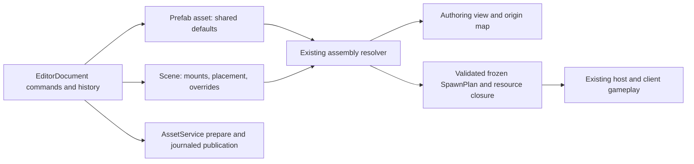

# Prefab workflow proposal

**Scheduling update, 15 October 2026: Planned, complete R4 (C + F)** in the [main roadmap](../architecture/DarkAngel_Implementation_Handoff.md#recommended-development-order-15-october-2026). Refactor and agreed scene-scale implementation are complete except explicit deferrals. Keep this architecture proposal and its acceptance criteria; the [placement/swap design](future/PREFAB_PLACEMENT_DESIGN.md) supplies compatible Swap and P0–P4 sequencing. Apply Selected and identity-preserving conversion are required for R4 completion. Adopt the [UX standards](future/EDITOR_UX_OVERHAUL_PLAN.md). Source findings below are dated research, not fresh verification.

Research and architecture inspection: 14 October 2026. Status: proposal only; no prefab implementation or new verification is claimed. This complements PREFABS_AND_COMPONENTS_TODO.md. It does not change the refactor prompt, approved runtime ownership, or milestone status. Claude's exercise extraction and verification remain separate work.

I recommend a Prefabs workspace backed by the existing assembly graph, EditorDocument commands, and AssetService publication. A scene owns a placement and its overrides; a prefab asset owns reusable defaults. Existing scene resolution produces the same kind of SpawnPlan consumed by Play. Prefab editing must make the ownership of every edit visible.

The first useful delivery is an altar, door, platform or pickup with its own model: create the reusable definition, place independent copies in two scenes, override one setting, edit the shared model, Save, and start fresh Play with independent persistent state.

The research supports familiar instance overrides, Revert, and a separate definition-editing context. Unity documents property/component overrides, override precedence, and instance position/rotation as distinct from template defaults. Its prefab editing mode provides isolation and context views. Godot demonstrates reusable scenes with shared defaults and local overrides. O3DE's template/instance/link/patch architecture closely resembles DarkAngel's existing assembly mounts. These are workflow references; the recommendations below are derived from DarkAngel's code, not proposals to adopt those engines' implementations. Sources: [Unity instance overrides](https://docs.unity3d.com/6000.0/Documentation/Manual/PrefabInstanceOverrides.html), [Unity prefab editing](https://docs.unity3d.com/6000.0/Documentation/Manual/EditingInPrefabMode.html), [Godot scene instances](https://docs.godotengine.org/en/stable/getting_started/step_by_step/instancing.html), [O3DE prefab architecture](https://docs.o3de.org/docs/engine-dev/architecture/prefabs/).

The current foundation is substantial. Source inspection identified the following extensions needed for the workflow.

| Verified by source inspection | Consequence for the design |
| --- | --- |
| assembly.cpp resolves stable entity keys, mounts, exports, bounded composition and typed patches. IDs derive from placement/mount paths and local entity keys. | Use this resolver and preserve its existing identity rules. Names, file paths, mesh changes and ordinary property edits must not regenerate entity keys. |
| Mount records currently contain an asset reference and patches; visit() adds a scope but applies no placement transform. | Add a real mount placement transform before offering movable groups. Baking world coordinates into every member's overrides would prevent useful propagation of template layout edits. |
| patch() supports AddEntity, RemoveEntity, reflected SetProperty, ReplaceSlot, SetSpawn and script binding operations. | Gameplay JSON fields need validated patch operations before their Inspector edits can become instance overrides. |
| EditorDocument saves all its sources as manifest/record snapshots, including mounted definitions. Its history also contains the complete source map. | A new external prefab file will not automatically update those copies. Linked dependencies must be distinguished from document-owned sources in open, refresh, history, Save and Play preparation. |
| EditorDocument.prepare_source() can replace an existing source but cannot introduce a new source into its closure. Nested placement property edits are explicitly refused. | Introduce bounded document commands for mount insertion, dependency resolution and scoped edits. Do not construct an alternate document/history store. |
| editor_ui.cpp structural component helpers accept only objects belonging to the root assembly. | Reuse the Inspector through commands that know the selected object's origin and edit scope. Merely adding a prefab tab would leave mounted gameplay objects uneditable. |
| AssetService's coordinated native Save allowlist does not contain scenes or prefabs. File > Save All publishes gameplay drafts and then saves the scene separately. | Extend the existing publication mechanism for assembly sources and scene manifests before promising atomic Apply to Prefab. Current APIs do not already provide that transaction. |
| SpawnPlan is flat. Collision excludes a gameplay object's own model when that object is an altar, pickup or mover. | The initial movable prefab puts its model and mover on the same entity. A child mesh will not automatically ride a door or platform merely because it belongs to the same assembly. |

Inspection pointers: engine/runtime/assembly.cpp; tools/editor/editor_document.cpp; apps/editor/editor_ui.cpp; apps/editor/editor_controller.cpp; engine/assets/asset_service.cpp; apps/editor/scene_collision.cpp; tests/assembly_tests.cpp; tests/editor_tests.cpp.

The proposed ownership is:

**Asset and source contract.** Use content/prefabs/*.daprefab, with a native prefab kind and the existing assembly entity/mount/export representation. The extension distinguishes reusable assets from travel destinations and avoids putting them into the current .dascene travel picker. It is an assembly source handled by the existing resolver, not another gameplay object format. Exact source/document version changes are part of the first design checkpoint.

Prefab AssetIDs and local entity keys are explicit and persistent. Scene mounts refer to the AssetID. Any source locator is validated against that identity; a rename must preserve the identity and update affected locators transactionally. Model, item, NPC, audio and script references continue to refer to their existing assets. Creating a prefab does not duplicate the referenced mesh, material, item or behavior asset. Duplicate Prefab creates a new asset and remaps its authored entity/export/binding keys and internal references coherently.

Introduce declared external assembly dependencies into the scene/document format. Document-owned sources remain editable and journaled by the document; externally linked sources are resolved through the project asset inventory. Existing embedded assemblies retain their current semantics until an explicit link/extraction command is used. Loading old content must not silently turn embedded definitions into live external links.

Keep a validated dependency snapshot for candidate preparation and historical recovery. Published dependencies are refreshed before authoring materialization and fresh Play. A stale snapshot is shown as stale rather than silently used as the current definition. Undo/Redo changes the document's owned edits and then resolves the appropriate current dependency baseline; it must not accidentally restore an old shared prefab from a scene history entry. A dependency change invalidates prepared edit tokens and requires revalidation without discarding unsaved scene edits.

Cooking records the full prefab/resource dependency closure and frozen generations using the existing catalog/CAS conventions. The final gameplay representation remains a resolved plan with ordinary objects and existing components. Gameplay sessions do not need a mutable prefab manager or editor source access.

**Creation and placement.** The Scene Inspector gains Create Prefab from Selection. Initially this takes one existing object, including its model and compatible gameplay components. The dialog chooses a name/folder and shows the pivot. The object's transform is normalized into prefab-local coordinates, with its current scene pose becoming the mount placement. Internal references are remapped; unresolved external references require explicit exports or are reported before creation.

Once identity-preserving conversion is implemented and verified, Replace Selection with Linked Instance is the normal workflow. Creating the file, adding the mount, preserving references and removing the original are one staged authoring operation. If that cannot be committed coherently, creation leaves the original object intact; it must not silently reset its persistent state.

Prefabs appear as a searchable category in Assets, as a category in Place, and in a dedicated fixed Prefabs workspace. Dragging or choosing Place uses the existing picking and placement path. Duplicate Instance allocates a fresh mount identity while keeping the source link and local overrides. Delete Instance removes the mount as a single undoable command. Referenced prefab deletion is refused with a list of consumers; rename/move waits for dependency-locator updates to be supported.

The Scene outliner displays an instance row with a prefab badge and expandable contents. Selecting the instance moves its placement; selecting an internal object edits that member. The container can be an editor selection target without creating an extra gameplay entity. This needs an explicit selection representation for a mount as well as an object; the current single StableId selection is insufficient for group operations.

**Definition editing.** The fixed Prefabs workspace uses the same viewport, Inspector, component widgets and command model as Scene authoring. It owns a prefab document and selection, with its own revisioned history; the same asset must have one authoritative draft in the editor. A header always identifies the prefab and says Editing Prefab. Open Prefab from an instance selects this workspace. The first version edits in isolation; in-context editing can be added later with surrounding objects visible but locked.

Preview is presentation of the authoring document. It does not collect items, discover altars, execute authoritative scripts, move runtime platforms or write saves. Gameplay is checked in a fresh scene Play session. Existing supported script bindings are preserved and validated; creating a second script behavior system is outside this work.

Save is explicit and uses private candidate validation and journaled publication. Unsaved prefab edits appear in its own preview. Saved edits refresh dependent authoring views while preserving scene-owned overrides. Running Play keeps its frozen generation; the new definition takes effect on the next fresh Play. A failed candidate preserves drafts and the last valid source/catalog generation. Switching workspaces preserves drafts; closing a document with unsaved edits offers Save, Discard or Cancel.

**Components and edit scope.** Extract source-edit commands and component adapters from the current Inspector helpers. An adapter provides the component key, defaults, decoder, compatibility rules, typed reference fields and supported overridable fields. It delegates gameplay validation to existing decoders and assembly checks. It is editor metadata, not a new ECS or gameplay registry. Place and Add Component share the same defaults.

On a normal scene object, Add/Remove Component changes the scene source. In the Prefabs workspace, it changes the prefab source. On an instance member, it creates an instance patch. Show unavailable combinations with the existing rule's reason, including spawn/model and encounter/model restrictions. Validate the complete candidate after a change rather than relying only on which menu entries were enabled.

Include a Model component picker in this slice. It attaches or replaces a model on the same altar, pickup or mover entity. Show whether the picker changes this instance or the shared prefab. Opening the referenced model asset edits that shared asset and must be visibly distinct from replacing the reference.

**Placement and override contract.** Add an explicit mount placement transform, composed when resolving prefab-local transforms into the flat plan. Existing mounts without it use identity, preserving old content. Apply template defaults and local overrides in prefab space, then compose the placement. The initial gameplay profile should support position and yaw with unit mount scale; pitch/roll and scaling are added only once every collider, volume, arrival offset and mover distance has defined behavior and matching tests. Existing supported local model transforms remain available. Unsupported group operations are disabled with a reason.

Ordinary placement position and rotation belong to the scene instance. They do not appear as template-property overrides and are never included in Apply to Prefab. A changed template layout therefore moves non-overridden members relative to each instance's placement, while leaving the instances at their authored locations.

Keep reflected SetProperty for existing type/property IDs. Add schema-validated component operations for AddComponent, RemoveComponent and SetComponentField, plus explicit model-reference removal where necessary. Target stable local entity keys and registered component/field identifiers; avoid arbitrary JSON-pointer edits and array-index-based targets. Start with the scalar/reference fields needed by altar, pickup, mover and interactable forms. Structural collection edits can follow with stable element identities.

Show inherited values normally and overridden values with a marker and a per-field Revert button. An Overrides panel lists changed fields and added/removed components with their source value, instance value and owner. Setting a field back to its source value removes the redundant patch. Removing an upstream component makes its old field overrides unresolved; preserve them for explicit repair. A compatible upstream value change is not a conflict: the local override still wins.

Revert affects the selected local patches only. Apply Selected to Prefab stages the selected values into the definition and removes precisely those instance patches; unrelated overrides remain. It shows the target prefab and affected placements before publication. This is a recoverable multi-source change with one history group and one publication transaction. Do not ship Apply as two independent writes. Initial Apply targets the directly linked prefab only; nested-target selection and variants wait for a later increment.

For shape changes, show which entity, component, export or field no longer exists. Do not silently drop failed patches. O3DE documents best-effort skipped patches, but DarkAngel already rejects unresolved required targets; retain that strict cooked/Play boundary. A repair view may display the last valid result with diagnostics, while the invalid candidate remains unpublished. Validate affected scene roots before publication, within declared bounds, and identify any consumer that needs explicit repair.

**Persistent identity and conversion.** Ordinary edits, model replacement and placement movement keep all existing keys. New placement or duplication creates fresh keys. Definition names and file paths are excluded from identity. Runtime discovery, collection, door state and checkpoint records remain owned by the host world ledger, not the prefab draft.

Converting a scene-local object to a mount changes its current resolver path, so retaining its old local key alone does not retain its runtime ID. I recommend a bounded, scene-owned retained-identity mapping for this explicit conversion, stored on the top-level mount and keyed by the prefab member's local key. The resolver validates uniqueness and uses that mapping consistently for objects and all expanded entity references, including the current direct derivations for encounter owners and spline references. Prefab definitions cannot carry scene retained IDs. New duplicates clear retained IDs and derive new ones normally. Existing IDs are never reassigned to unrelated newly created members.

This is a proposed assembly extension, not existing support. Review and prove it before making conversion or unpack available. Unpack is deferred until it can preserve identities and references by the same explicit mechanism. Save deletion/reset remains a separate user action. No ledger-wide rewrite is needed for ordinary prefab edits; incompatible changes to gameplay kind or persistent-property policies must receive their existing validation and an explicit migration/reset decision where required.

**Modules and publication.** Use the completed refactor's narrow authoring/service interfaces; recheck them at the R4 planning checkpoint. Prefab implementation should use focused modules and public commands, without adding substantial new behavior to main.cpp. Use R4 dependencies and the explicit deferred list; do not reopen completed refactor work.

| Responsibility | Existing owner / proposed extension |
| --- | --- |
| Component defaults, source edits, compatibility and overrides | Reusable SceneObjectCommands and component adapters in editor code; same API used by UI and exercises |
| Assembly draft, revision, source ownership and Undo/Redo | Extend EditorDocument; prefab and scene documents use this owner |
| Prefab browse/edit/presentation | PrefabWorkspace in the editor, receiving a narrow document/asset/preview context |
| External assembly lookup and dependent-scene discovery | Project source inventory and an assembly dependency resolver, validated by AssetID |
| Mount transforms, stable reference expansion and typed patches | Existing runtime assembly resolver, with bounded additive extensions |
| Private candidate validation, cooker dependencies, CAS and publication | Extend AssetService's existing native publication path for prefab sources and document manifests/records |
| Fresh scene preparation and collision | Existing Play preparation and completed [scene-scale](current/SCENE_SCALE_PLAN.md) per-model collision/static-layer path, from refreshed placements; no return to whole-scene baking |
| Gameplay, replication, inventory and durable world state | Existing scene authority/client, inventory and persistence services |

Stage prefab sources, scene manifests, new immutable record files and referenced native drafts in one private candidate. Recheck source hashes and document revisions before commit. Extend the existing recovery journal to coordinate file heads with catalog publication; filesystem multi-file writes are not inherently atomic. Only install validated document candidates after a successful commit, and recover an interrupted commit before accepting readers/writers. Treat current document/Save separation as work to be done, not an existing guarantee. Dependency refresh and Undo must use source ownership rather than replacing the entire editor session.

**Delivery order and acceptance.** Each row is a coherent increment with focused checks. Do not start implementation while the current shared-checkout verification is running.

| Increment | Reviewable result | Acceptance |
| --- | --- | --- |
| 0. Contract and source foundation | External-link ownership, versioned prefab/document source contracts, dependency resolution, retained identity rules and publication design | Existing embedded scenes still open identically; missing/cyclic/stale dependencies reject without losing drafts; identity and conversion examples resolve deterministically |
| 1. Useful object composition | Shared component commands, Add/Remove Component, Model picker on ordinary scene objects | Altar/mover/pickup plus model through Inspector; Undo/Redo; valid Save/fresh Play; invalid combinations leave source unchanged |
| 2. Reusable prefab loop | Prefab assets, workspace, Place, instance selection and movement, explicit Save and cross-scene refresh | Create a modelled altar prefab; place copies in two scenes; edit model; reopen and fresh Play both scenes; mount identities and distinct discovered state survive |
| 3. Overrides and conversion | Field/component patches, markers, Revert, atomic Apply Selected, identity-preserving conversion | One copy overrides radius while another follows defaults; template changes preserve the override; Revert restores inheritance; conversion preserves collected/discovered state and references; duplication does not share it |
| 4. Composition extensions | Multi-object capture, nested prefab editing, variants, in-context view and identity-preserving Unpack | Scoped edits affect their intended owner; nested transforms and exports resolve; variant rebase is explicit; structural deletion conflicts are repairable |

The first complete version is increments 0-3. It deliberately delivers reusable gameplay objects before multi-selection, arbitrary runtime parent/child behavior or deep nested override authoring. Legacy nested assemblies remain supported by their current resolver; the new workflow must accurately report its narrower initial editing scope. Existing one-level variants retain their base-fingerprint/rebase rule. Editor camera navigation is the earlier R1 prerequisite in the main roadmap; this prefab milestone reuses it.

Tests should use public commands rather than direct file surgery: edit -> Undo -> Redo -> Save -> fresh Play; independent copies across scenes; a shared model change; one local override; retained identity through conversion; host/guest agreement on the same frozen closure; failed publication and external stale-writer retention. Test mount placement against actual model collision and game-object arrival/movement behavior when the resolver changes. Add focused cases to the existing assembly/editor/asset test families and one D3D12 authoring gate; use the current M8 party/travel gate at the integration checkpoint. Broad provider/network/device matrices are not required for every Inspector edit.

Recommended decisions for review: .daprefab under content/prefabs; one fixed Prefabs workspace sharing Inspector code; explicit Save; externally linked assembly dependencies; one-entity gameplay prefabs first; field-level overrides and Apply Selected; scene-owned retained identity for conversion; nested authoring/variants/in-context editing after the first useful version. These are recommendations, not new locked architecture decisions.
