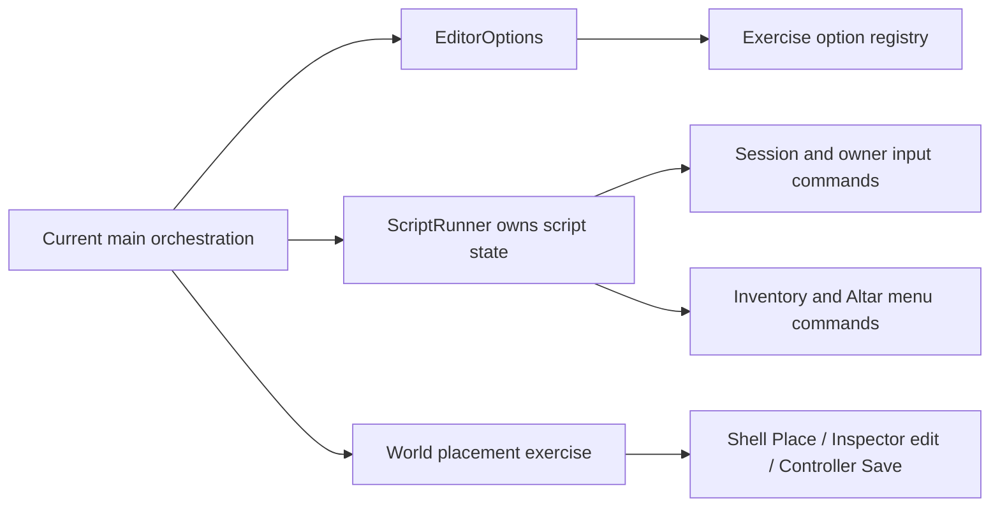

# Audit-driven refactor

Requested through `CODEX_REFACTOR_PROMPT.md` on 14 October 2026. Starting commit: `65db8aa`.

## Scope and sequence

Preserve existing behavior, CLI spellings, authoring commands, runtime ownership and authority. Prefabs, Add component and Scene camera modes remain separate TODOs. Follow the prompt's order: baseline; exercises and ScriptRunner; EditorApp services; PlayController and Gameplay Inspector; header narrowing; runtime responsibility splits; shared utilities; CMake and authoring test split. Each increment must pass its required verification before committing or starting the next step. Formatting changes have separate commits.

## Step 0: baseline, verified

- No compiler, build, CTest or editor process was running at orientation.
- Git started with only the user's untracked RoyalCombat and RoyalTraining `.records/` folders. These are protected, together with the scene sources.
- Pinned MSVC activation returns the environment passed to CMake. Cache: `D3D12_SUPPORTED=TRUE`, `WINDOWS_SDK_VERSION=10.0.26100.0`, `VCPKG_MANIFEST_INSTALL=OFF`.
- Guarded dry-run initially listed 296 potential first-party compile/dyndep/link operations, without Diligent, Effekseer or glslang object rebuilds. Actual build passed in 13.890 s; after dependency scanning, no compilation or linking was needed.
- `.clang-format` establishes LLVM-based formatting with four-space indentation and a 140-column limit. No existing source is reformatted at this point.
- Full guarded build and fresh M8 slice run serially. Logs: `evidence/refactor-baseline-build.log`, `evidence/refactor-baseline-slice.log`. Measurements and completion receipt will be recorded in `evidence/refactor-baseline-metrics.json` and `evidence/refactor-baseline.json`.

Measured starting source: 360,484 bytes, 1,613 lines, 77 distinct exercise option spellings (including `--exercise` and the value-bearing import option). Recorded Ninja object dependencies: world_session 65 objects / 45 targets; scene_definitions 32 / 16; character_scene 28 / 16; scene_client 30 / 16; scene_authority 29 / 16. These counts use object outputs only, excluding dependency-scan outputs; they are not directly comparable to older counts using a different output selection. Most recent recorded main compilation: 177.083 s. Historical executable edges include link and DLL deployment; they are not controlled benchmarks.

### Regression exposed by the first fresh slice

The initial slice failed in 92.718 s after placement, solo and save/load passed. The party log showed a downed guest still at zero Health at tick 132, then both members alive after wipe/respawn. `hold-interact:420` consumed 420 rendered frames, which can represent fewer than the 180 simulation ticks required for a three-second revive. Gate success depended on rendering speed.

The bounded baseline repair keeps requesting the same authenticated Interact command and measures the hold budget in simulation ticks. It leaves keyboard input, party rules, request cadence and authority unchanged. Original failed logs/receipts/captures are retained in `evidence/refactor-baseline-failure/`.

Confirmation guarded build passed in 64.968 s. M8/M6/HUD CTest passed 14/14 in 23.594 s. The fresh slice passed all six gates in 201.860 s, including party revive to 50 Health, wipe/respawn, party travel, fast travel preserving the checkpoint, and respawn in the other scene. Host and guest receipts both show five arrivals at epoch 5 with no travel error. Both scenes generated their own `.dacollision` files in the disposable fixture copy. Network evidence remains same-machine UDP/D3D12 only. Full CTest is not rerun for this bounded baseline repair.

### Controlled incremental measurements

Command for each measurement: pinned `cmake --build build/m5-editor-relwithdebinfo --target DarkAngelEditor --parallel 4 -- -k 0`, with the returned MSVC environment and a guarded dry-run first. One source was touched at a time; its original timestamps were restored afterwards to avoid invalidating unrelated test binaries. Source bytes and compiler/linker flags were unchanged.

| Touched source | Editor target rebuild | Relevant source compile, Ninja log |
| --- | ---: | ---: |
| `apps/editor/main.cpp` | 70.890 s | 39.562 s |
| `world_session.hpp` | 121.218 s | main.cpp 51.621 s, with other compilations sharing four jobs |
| `apps/editor/editor_world_objects.cpp` | 45.188 s | 9.031 s |

Logs and dry-runs are `evidence/refactor-baseline-touch-*.log`; totals are in `refactor-baseline-incremental.json`. Warm controlled times differ considerably from the audit's older 130–200 s compilation observations. Do not attribute that difference to this refactor: no extraction or compiler optimization has occurred yet.

## Ownership and dependencies before extraction

`main()` owns the platform window/device, renderer resources, editor Controller/Shell, Play session, party adapters, script state, runtime inventory/altar UI and saves. Its closures share these locals. Runtime libraries retain their existing public boundaries. The refactor will replace this implicit sharing with service ownership and narrow contexts, without relocating the entire function into EditorApp.

## Step 1a: exercise registration and scripts, verified

- `editor_options.{hpp,cpp}` owns the editor argument contract and validation. `exercises/registry.{hpp,cpp}` registers all 77 existing exercise spellings and their unchanged prerequisite flags/workspace selections. No exercise CLI spelling remains in main.cpp.
- `exercises/ScriptRunner` owns parsed steps, cursor, interaction counts and hold timing. Its context exposes the gameplay session, the controlled SceneClient, travel counters, capture/quit signals and a menu command callback. It cannot access device/window resources, the save database or networking adapters. Inventory and altar verbs continue through the existing RmlUi menu adapters. Gameplay verbs continue through the existing owner input/interaction paths; the existing host-only `down` fault-injection command remains host-only.
- `world_place_exercise.{hpp,cpp}` moved into `exercises/`; it still calls Shell Place, Inspector component editing and Controller Save.
- Added foundation `check.hpp`; new extracted translation units use it. Other local checks are retained until touched.
- Main shrank from 360,947 to about 339,100 bytes (about 6%). Frame assertions and scenario bodies remain in main and are the next part of step 1. This increment does not complete exercise extraction or the EditorApp/service split.
- Ninja's old generated `CXX.dd` named the moved placement object and prevented the initial dry-run. The single stale editor dependency map was backed up, then regenerated through its pinned CMake target before retrying the dry-run. No build tree or dependency cache was deleted; D3D12/SDK/manifest cache values are unchanged.
- Guarded full build passes (159.094 s); M8/M6/HUD CTest passes 14/14 (30.469 s). Exercise suite: all 67 cases have passing runs on this increment (14 native cases ran alone in the initial pass; 53 editor cases reran after the fixture-only repair, with the spline case confirmed separately). Native binary hashes were retained and checked. The final fresh M8 slice passes 6/6 in 241.406 s; separate-process party verification passes 7/7 in 195.922 s. Raw results are in `evidence/refactor-scripts*.{json,log}`; the confirmation receipt retains both initial failures separately from final passes.
- Static comparison against `873799e` confirms all 76 boolean exercise options and every prerequisite/workspace assignment are identical, and the value-bearing import option is retained. This is a compatibility mapping check, not a substitute for editor gates; see `evidence/refactor-script-cli-parity.json`.

### Fixture regressions exposed by broader verification

The exercise suite copied Training into Duel, Range, Guards, Archer, Senses, Encounter, audio, Lever and Spline scenes without changing their scene identities. Per-scene collision baking therefore produced duplicate collision UUIDs. A leftover Spline alias also made rest resolve the Training identity to the wrong source path. The test-only `write_fixture_scene` helper now gives each copied scene a distinct root and updates its source asset identity. Gate/Temple travel fixtures already had distinct identities and retain them. All fixture scene roots were audited for uniqueness; the spline gate and fresh slice passed after the last alias was repaired. Runtime identity validation was preserved.

Initial errors are retained in `refactor-scripts-exercises-first-failure.log` and `refactor-scripts-slice-first-failure.log`. The native pass was not repeated for this fixture-only correction: `refactor-scripts-retained-native.json` records its cases and unchanged binary hashes. `effect-reaction.json` explicitly marks the retained native cases.

### Measurements after step 1a

| Metric | Baseline | Step 1a |
| --- | ---: | ---: |
| main.cpp bytes | 360,947 | 339,114 |
| Exercise CLI spellings in main.cpp | 77 | 0 |
| Touch main, editor rebuild | 70.890 s | 69.047 s |
| Main compilation for that touch | 39.562 s | 39.431 s |
| Touch world_session.hpp, editor rebuild | 121.218 s | 112.781 s |
| Touch inspector, editor rebuild | 45.188 s | 38.141 s |
| world_session.hpp dependent objects | 65 | 66 |

The main reduction is 6.0%. The compile-time change is negligible; the dominant frame/scenario bodies remain. Header fan-out grows by one object because ScriptRunner is now its own translation unit. Header narrowing is still pending. The indicative 15 KB / 15 s targets are not met. No PCH, compiler or linker optimization was introduced.

## Verification boundary

The baseline, timer repair and completed extraction increments are freshly verified as described above. The broader 107-test checkpoint remains historical; the current subset is 14 tests. Network gates establish same-machine UDP/D3D12 behavior only. Step 1 and the full refactor remain incomplete.

## Step 1b: authoring scenario module, verified

`exercises/exercise.hpp` defines the frame, finish, done and result interface. `AuthoringSources` implements it with the existing source comparison, effect preview, reference navigation, graph canvas, creation, history and actor authoring frame commands. It also owns the final revision, validation and history-validation assertions. Its six-field context contains options, Controller, Shell, the prepared character-resource holder, current gameplay-session pointer and immutable authoring-scene baseline. It has no device, rendering resources, networking adapter or save database.

The source body and frame order are preserved. Main calls the exercise at its original pre-UI frame phase and completes its revision, validation and history checks in `finish()`. Main measures 298,511 bytes before formatting: down 17.3% from the verified baseline. The new translation unit compiles in 8.495 s; the accompanying main compilation is 42.077 s during the guarded full build, sharing the machine with other first-party work. These are Ninja edge times, not a controlled incremental comparison.

Guarded full build and M8/M6/HUD subset pass (14/14). All 20 binding/navigation prefix gates pass, including effect preview failures/reprepare/correction, source comparison, kit publication and fresh Play. Actor and pending-creation suites pass fresh Play, Character/Player panels and draft isolation; history panel and animation workflow pass. Explicit validation, invalid-draft rejection, history validation and frozen effect revision checks pass. Graph preview (including its native pose check), Character previews and the six-source creation/Save/fresh-Play vertical pass. Their unchanged native authoring API checks are retained from verified checkpoint `0ea18a0`; this change only moves editor scenario code. Results: `evidence/refactor-authoring.json`. Additional scenario/input/render assertions remain in main; step 1 is not complete.

The initial effect-revision probe used the fixture's custom evaluator; the preview correctly rejected it. Retrying with an ordinary finite effect passes. This was a probe selection correction, with no runtime change.

## Formatting checkpoint and continuation

Formatting-only commit `cf64e39` applies the 140-column policy to the 12 extracted/new C++ files. Include order is preserved; main and unrelated sources are not reformatted. Final guarded build passes in 69.296 s, native subset 14/14 in 24.813 s, and a fresh M8 slice 6/6 in 265.109 s on the formatted binaries. Main remains 298,511 bytes. Latest main compilation is 34.188 s, a normal rebuild observation rather than a controlled benchmark. No build/editor/test process remains running at this checkpoint.

Verified implementation commits: `873799e` baseline timer repair; `0ea18a0` registration/ScriptRunner; `fb12065` authoring-source exercises. Fixture corrections are `323782d` and `d35ca7a`; formatting policy is `baf7976`.

**The requested refactor is not complete.** Finish step 1 before introducing EditorApp: extract synthetic input, mouse/picking/menu exercises, preview/presentation/gameplay final assertions and the remaining setup branches. Use separate narrow contexts for authoring, gameplay, CPU preview snapshots, platform input and renderer readbacks. Preserve the Scene Place/Inspector/Save and public gameplay commands. Then proceed through EditorApp ownership, PlayController/Gameplay Inspector, measured header narrowing, runtime splits, remaining shared utilities, and CMake/test splits. Prefabs, Add component and Scene camera modes stay TODOs.

Resume by reading this report and `CODEX_REFACTOR_PROMPT.md`, checking git/process/cache state, and selecting the next bounded step-1 extraction. There is no authorization or product decision pending. Protected content remains the two Royal scene sources and their untracked `.records/` folders; do not stage them. Build command remains pinned CMake with `env=msvc_environment.activate()`, a dry-run first and one heavy job at a time. The reusable local verification helpers in `.cache/refactor_work.py` and `.cache/refactor_authoring_work.py` are diagnostic working files, not product APIs; the fresh normal gate scripts remain the reproducible acceptance paths.

Two verifier assumptions needed correction during this increment. Actor and pending-creation suites normally regenerate their fixture independently; when retaining the native fixture, the first suite's published `gui_*` files must be backed up before the second reuses those names. Only three owned test-fixture files were moved into `.cache/refactor-actor-generated-backup/`, with resolved paths checked under the build fixture. The animation verifier now obtains its action from the current kit's heavy binding rather than assuming `heavy.daaction`; other composer modes retain their original fixture. Initial failure logs are retained separately.
