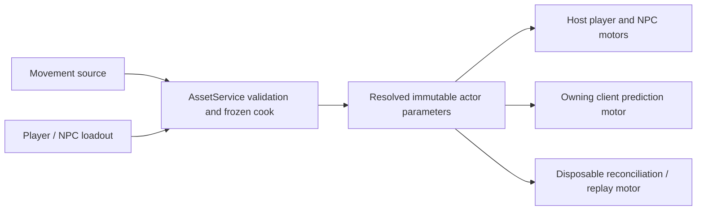

# Editable gameplay configuration: ownership and movement MVP

15 October 2026. **Design only; no settings or asset types added yet.** Resume through [next authoring work](AUTHORING_NEXT_STEPS_2026-10-15.md). This follows the existing [actor ownership contract](../../architecture/Actor_Gameplay_Design.md), qualifying the Character/Player wording in the older [extensibility audit](../current/EXTENSIBILITY_AUDIT.md).

## Recommendation

Put reusable movement values in a native **Movement Profile** asset, referenced by the **common Actor Loadout** used by Player and NPC. Edit that reference and its fields directly in the Player/NPC tabs using the same embedded profile panel. Character remains presentation: skin/rig/sockets, not movement rules or starting gameplay stats.

An actor owns a profile reference; the profile owns reusable defaults. **Edit Shared Profile** changes everyone referencing it. **Duplicate Profile and Assign** makes a local design variation without affecting the other consumers. Show the profile name, source, consumers and edit destination beside the fields. Avoid silently creating per-actor overrides on top of a profile in the first version.

Example: Player references `Human Player`; Royal Guard and Archer reference `Human NPC`. Duplicate `Human NPC` as `Heavy Guard`, reduce walk speed and assign it to that NPC. A spawn prefab still references the NPC asset; it does not carry another copy of movement numbers.

## Where configuration should live

| Setting | Existing/recommended source of truth | Where to edit |
| --- | --- | --- |
| Skin, rig and visual attachment compatibility | Existing Character/presentation assets | Character |
| Health/Stamina and other starting attributes | Existing attribute schema + Actor Loadout starting values | Player/NPC, shared loadout forms |
| Base locomotion speeds, acceleration, jump/gravity/timing | Proposed `.damovement` Movement Profile referenced by Actor Loadout | Player/NPC Movement panel; searchable asset form |
| Controls and input mappings | Existing `.dainput` referenced by Player | Player input mapper |
| Camera rig, aim offsets and local camera preferences | Existing Player camera definition; local preferences separately | Player cameras; local settings for preferences |
| NPC preferred range, recovery, sensing and tree parameters | Existing `.danpc` tuning/senses + `.dabehavior` | NPC |
| Ability costs/timing, range, dodge motion and invulnerability | Existing abilities, effects, combat kits and mask references | Ability/Effect/Kit/Mask forms |
| Item quantity/equipment rules | Existing `.daitem` and Player starting inventory | Items/Player |
| Interaction radius, pickup contents, mover path, altar arrival | Existing scene component; reusable default in prefab with instance patch | Prefabs or Scene Inspector |
| HUD/nameplate document and attachment | Proposed UI asset references on Player/NPC | Player/NPC UI panel; UI workspace for the document |
| Puzzle document and scene-specific puzzle binding | Proposed UI attachment/controller on the object/prefab | UI workspace + Scene/Prefab Inspector |
| Default Player, front-end screens and game-wide party/revive rules | Proposed thin project game definition, backed by runtime data | Project Settings forms that edit that asset |
| Skybox/procedural sky, ambient/reflections/shadow defaults and fog | Proposed SkyDefinition/LightingProfile selected by SceneRenderingSettings | Tools > Procedural Skybox and Tools > Lighting |
| Post-processing effect parameters | Proposed PostProcessProfile; scene default and explicit camera override | Lighting > Post Processing; Edit profile from Assets |
| Static light-bake quality/UV/sample settings | Proposed LightingBakeSettings; generated scene-specific CAS products separately | Lighting > Baking |
| Imported model material values and texture assignments | Native MaterialInstance plus stable model-slot assignment metadata; prefab instance assignments where needed | Assets model/material editor, shared with prefab reference navigation |
| Audio/video/accessibility/key preference overrides | Per-user preferences/settings, separate from authoritative content | Runtime settings and Editor Settings as appropriate |
| Fixed tick rate, solver/query budgets, protocol limits and contact-overflow guards | Native engine/qualified platform configuration | Remain code/engineering settings |

Current **Project Settings** is a placeholder in `editor_workspaces.cpp`; it is not an existing gameplay configuration store. Do not put all settings into an editor-only singleton or a free-form global key/value file. Forms should navigate to their owning asset and use existing drafts/history/publication.

The [rendering plan](ENVIRONMENT_LIGHTING_POST_PROCESSING_PLAN.md) and [Assets/material plan](ASSETS_MATERIAL_EDITING_PLAN.md) define these presentation settings separately from authoritative actor parameters. Local render quality/exposure preferences never become motor/gameplay configuration or persistent world state.

The game definition can be a small native `.dagame` source under `content/game/`, selected by the project/launch configuration. Its eventual scope is composition: default Player, main/pause/loading screen references and validated party rules. It is a proposal, not a prerequisite for the first movement profile or document preview. Use the existing project manifest if Claude's later refactor supplies an equivalent runtime-data owner; do not create both. The editor, future client and headless host must resolve the same gameplay section. Client-only UI dependencies must not force a headless renderer to load.

## What is actually hardcoded now

Source inspected on 15 October: `engine/runtime/character_motor.cpp`, `character_motor.hpp`, `actor_assets.hpp`, `scene_definitions.hpp`, `scene_authority.cpp`, `scene_client.cpp`, `behavior.hpp`, `party_lifecycle.hpp`.

| Motor value | Current value | First movement-profile delivery |
| --- | --- | --- |
| Standing locomotion speed | 5 m/s | `walk_speed_mps` |
| Crouched locomotion speed | 2 m/s | `crouch_speed_mps` |
| Horizontal approach toward target velocity | 30 m/s², independently on X/Z | `acceleration_mps2`, preserving that calculation |
| Jump launch velocity | 7 m/s above support velocity | `jump_velocity_mps` |
| Gravity magnitude | 20 m/s² | `gravity_mps2`, applied consistently in both velocity integration and Jolt update |
| Coyote time | 6 fixed ticks | `coyote_ticks` |
| Jump buffer | 6 fixed ticks | `jump_buffer_ticks` |
| Maximum slope | 45 degrees | Follow-up motor geometry/traversal profile field |
| Step up / floor stick down | 0.35 / 0.25 m | Follow-up traversal fields |
| Capsule/standing/crouch geometry | Native fixed capsule dimensions | Separate follow-up with collision-frame/prediction support |

The first authored default must reproduce today's calculation exactly. Do not change acceleration/braking into a different vector algorithm, change diagonal input handling, add sprint or infer speed from animation while extracting constants. Separate braking/air-control/sprint/aim fields should appear only when the motor supports their defined behaviour; disabled speculative controls would mislead authors. Dodge stays on the existing ability/action motion path.

`mMaxNumHits=32`, overflow failure/resynchronization, enhanced internal-edge removal, replay work limits and the fixed 60 Hz tick are not designer knobs. Keep them unchanged.

## Native source, cook and editor contract

Proposed source: `content/movement/*.damovement`, embedded persistent AssetID, kind/schema/name and the bounded typed fields above. Add a shared optional `movement` AssetID to `ActorLoadoutDefinition`; source locators follow the existing native-reference convention. The cooker validates kind, identity, schema, finite numeric values, legal signs and tick ranges, and records the profile in both Player and NPC frozen dependency closures.

Missing field on a legacy actor means the exact built-in legacy profile. An explicitly specified missing/wrong-kind profile is an error, not fallback. New Player/NPC templates assign an owned default profile. Explicit migration can populate references on old sources; opening or viewing them must not rewrite authored bytes automatically.

Keep a dependency-light immutable `MotorParameters` value in runtime code and a native Movement asset wrapper/decoder in assets code. The motor never opens files, calls AssetService or depends on editor JSON. Validate once when resolving the frozen profile and also at public runtime construction boundaries. Numeric maxima must fit existing motor state/network bounds and bounded collision work; establish named checked ranges with focused tests before exposing controls, not unlimited InputDouble values.

Extend the existing native source inventory, create/edit/prepare/commit/delete contracts and dependency discovery for `.damovement`. A changed shared profile invalidates every dependent prepared actor. The same shared Movement panel is used by Player and NPC; it provides New, Duplicate and Assign, Open, validation, Undo/Redo and explicit coordinated Save. Do not create a new profile-only history or publication store.

## Runtime and prediction contract

Carry resolved parameters through Player preparation and `CharacterSceneActor`/encounter preparation into every motor constructor. SceneAuthority uses the Player profile for each party member and the prepared NPC profile for each spawned/encounter actor. Today all party members use the session's Player definition; differing Player definitions per seat are separate work, not a consequence of adding profiles.

SceneClient's initial owner motor, prediction-world replacement and resynchronization paths must receive the same profile. `replay_motor` also constructs a fresh motor: add explicit parameter plumbing there and in OwnerPrediction, rather than leaving replay on defaults. Existing callers can retain an exact legacy-default overload. Observers interpolate received motor state and do not run a new locomotion simulation.

Include profile identity, generation/hash and actor-to-profile mapping in the prepared gameplay closure/handshake fingerprint. A host/guest mismatch must refuse readiness rather than let two motors simulate different constants. Source inspection must verify the existing fingerprint actually covers the new dependency; merely adding a field to a C++ struct is insufficient. Tick-based timing remains integer ticks; show milliseconds in the form as a derived aid, not a separate independently editable value.

Saving during authoring does not modify live motor parameters. Apply the new profile on fresh Play/session creation. Reconciliation history always uses the profile frozen for that session. Later mask/effect movement changes need source-owned grants, deterministic selection and history/epoch fences; they must not mutate the profile object in place. Persistent saves store identity/durable game state, not a second authoritative copy of arbitrary editor movement settings.

## Similar hardcoded values: migrate by owner

After movement, audit remaining gameplay constants in small families. Existing NPC tuning, sensing, camera and combat authoring should be extended where they already own the setting. `PartyRules` already validates revive range/time/health and wipe time but is currently composed into scene combat; expose its gameplay fields through the game definition when adding Project Settings runtime data. Keep jitter grace/timeouts and engineering limits separate unless there is a demonstrated game design need.

Avoid an editor-wide reflection sweep or a generic configurable-everything system. Each exposed value needs an identified consumer, units, validation, source ownership, fresh-session behaviour and authority/prediction policy. Do not repurpose mutable Health/attributes into base motor settings, or bind UI controls directly to a live server motor.

## Implementation and acceptance

1. Add the immutable parameters/decoder with exact legacy defaults and meaningful invalid-input cases; freeze ranges. First prove a standalone motor with a slower speed and changed jump behaves predictably.
2. Add `.damovement` cook/load/dependencies and optional common loadout reference. Integrate all authority, prediction, resync and replay constructors before offering the editor control.
3. Add the shared Player/NPC Movement form, create/duplicate/assign and Save. Add an owned profile fixture; do not rewrite protected Royal content during this increment.
4. Verify edit -> Undo/Redo -> Save -> reopen -> fresh Play; two NPC profiles and a Player profile in one scene; missing/stale profile and failed publication preserve the draft/prior cooked generation.

Focused existing motor/session/actor tests should cover unchanged default traces, authored movement under collision, owner correction/replay with nondefault parameters, and constructor replacement paths. Run the existing actual-mesh hut regression at motor integration without raising bounds. One editor gate proves both forms change the intended asset; one separate-process host/guest gate proves matching parameters and mismatch refusal at the integration checkpoint. Same-machine evidence remains same-machine evidence. A full unrelated UI/network matrix is unnecessary per numeric form change.

Likely files: `engine/runtime/character_motor.cpp`, `engine/runtime/include/darkangel/character_motor.hpp`, actor assets/cooker, scene preparation/authority/client, existing native authoring forms/commands and focused tests. Use the narrower headers/services after Claude's checkpoint; add no gameplay configuration to `main.cpp`.
